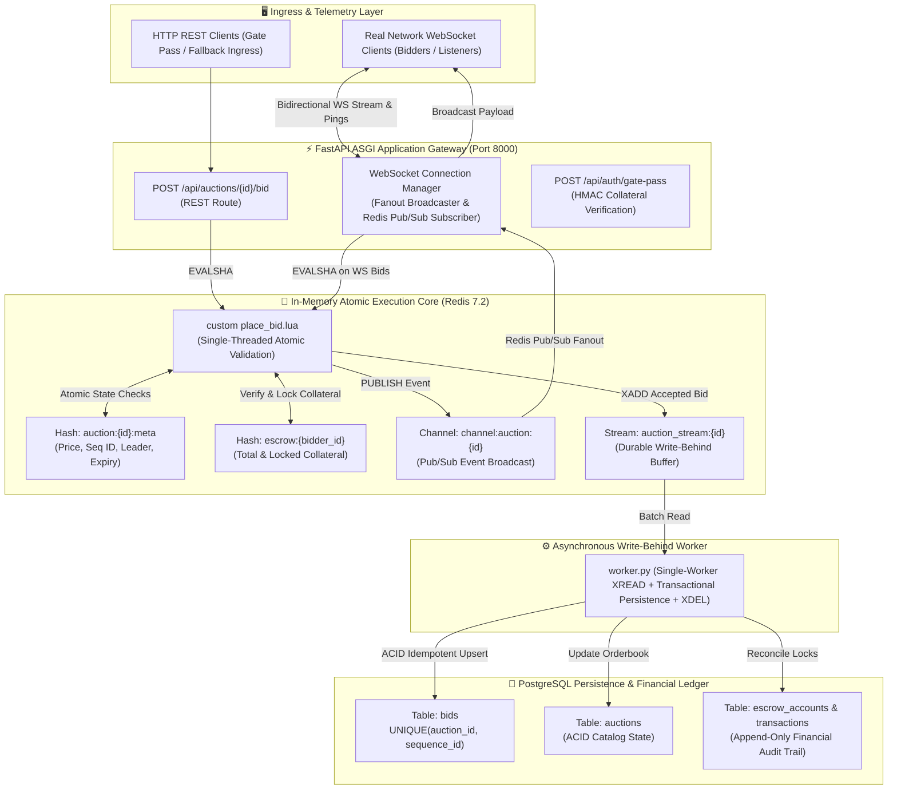

# ⚡ Gated Real-Time Auction Engine

[](https://fastapi.tiangolo.com/)
[](https://redis.io/)
[](https://www.postgresql.org/)
[](https://websockets.readthedocs.io/)
[](backend/tests/)
[](https://tejashr0716.github.io/auction/)

> **High-frequency, low-latency event-driven telemetry and orderbook engine for gated real-time auctions.**  
> Engineered with **FastAPI WebSockets**, **Redis Pub/Sub**, and **PostgreSQL**, enforcing strict orderbook invariants (zero duplicate sequence IDs, zero sequence gaps, monotonic price progression) under concurrent load through custom atomic **Redis Lua scripts** and asynchronous write-behind streams.

---

> [!NOTE]
> **METHODOLOGY & BENCHMARK TRANSPARENCY**  
> All performance metrics documented below distinguish between **in-process coroutine microbenchmarks** (using `VirtualClient` doubles to isolate Python event loop dispatch), **real network TCP WebSocket benchmarks** (measuring socket serialization, OS TCP buffers, and network round-trip), and **Redis Lua atomic execution**. Raw timestamped benchmark outputs are checked into [`benchmarks/results/`](benchmarks/results/).

---

## 🏛️ System Architecture



---

## 🎯 Key Engineering Invariants & Verified Guarantees

| Invariant / Mechanism | Architectural Implementation | Measured & Verified Outcome |
| :--- | :--- | :--- |
| **Race Condition Immunity** | Single-threaded atomic evaluation via custom **Redis Lua script** (`place_bid.lua`) | **Zero race conditions** under 3,000 concurrent bids across 50 async workers (`7,779.3 bids/sec`). 100% contiguous sequence chain ($1..N$) with zero duplicates and zero gaps. |
| **Real Network WebSocket Acknowledgment** | Direct WebSocket handler in `websocket.py` replying to client PING or BID receipts | **P50 Ack Latency: 1.13 ms** (P99: 9.89 ms) measured across 50 concurrent network TCP WebSocket connections. |
| **Network Broadcast Fanout** | Redis Pub/Sub listener triggering non-blocking `asyncio.gather` TCP socket sends | **P50 Fanout Latency: 2.42 ms** (P99: 6.19 ms) across 50 concurrent network sockets over TCP loopback (100% application-message completeness over TCP/WebSocket). |
| **Anti-Sniping Soft-Close Extension** | Lua script auto-extends auction deadline by `+30s` if bid is placed within final `15s` window | Neutralizes last-millisecond automated sniping advantages by reopening bidding to all participants. |
| **Economic Gating & Collateral Escrow** | Atomic escrow balance validation and collateral lock held in Redis memory | Rejects bids where unencumbered balance is below required collateral. Superseded bidders have collateral automatically freed. |
| **Durability Without Latency Penalty** | Asynchronous Write-Behind Stream Worker (`auction_stream:*` $\to$ PostgreSQL `bids`) | Single-worker `XREAD` batches persisted in atomic ACID transaction (bid ledger insert + auction update); messages pruned via `XDEL` only upon successful commit and retained on failure. |

> [!NOTE]
> **Bot Protection Scope:** Bot mitigation in this project consists of **economic gating** (verifying deposited escrow collateral before granting an HMAC gate pass) and **anti-sniping soft-close timer extension** in Lua. It does *not* include ML-based bot classification or CAPTCHA challenges.

---

## 🔬 Inside the Atomic Lua Script (`place_bid.lua`)

Standard multi-threaded or multi-instance web servers fail under bid flash events because concurrent read-modify-write patterns (`SELECT price` $\to$ `IF bid > price` $\to$ `UPDATE price`) allow duplicate winning bids. 

By executing bid logic inside a Redis Lua script using `EVALSHA`, the entire validation sequence executes as a single atomic transaction:

```lua
-- 1. Check Auction Exists & Status == ACTIVE
if status ~= "ACTIVE" or now_ms >= end_time_ms then
    return cjson.encode({ok = false, code = "ERR_AUCTION_EXPIRED"})
end

-- 2. Guard Against Self-Outbidding
if highest_bidder_id == bidder_id then
    return cjson.encode({ok = false, code = "ERR_SELF_OUTBID"})
end

-- 3. Validate Minimum Bid Increment
local min_required = current_price + min_increment
if bid_amount < min_required then
    return cjson.encode({ok = false, code = "ERR_BID_TOO_LOW", min_required = min_required})
end

-- 4. Verify Gated Escrow Collateral
if (esc_balance - esc_locked) < required_escrow then
    return cjson.encode({ok = false, code = "ERR_INSUFFICIENT_ESCROW"})
end

-- 5. Anti-Sniping Soft-Close Window Extension
if (end_time_ms - now_ms) <= (soft_close_window_sec * 1000) then
    end_time_ms = end_time_ms + (extension_sec * 1000)
    extended = true
end

-- 6. Atomic Collateral Reallocation & Orderbook Update
sequence_id = sequence_id + 1
redis.call("HMSET", meta_key, "current_price", bid_amount, "sequence_id", sequence_id, ...)

-- 7. Dual Distribution: Pub/Sub Broadcast + Write-Behind Stream Buffer
redis.call("PUBLISH", "channel:auction:" .. auction_id, event_json)
redis.call("XADD", "auction_stream:" .. auction_id, "*", ...)
```

---

## 📊 Reproducible Benchmark Evidence

All benchmarks were run against a live local instance (Apple Silicon arm64, Python 3.14, Redis 7.2, PostgreSQL 15). Raw outputs are preserved in [`benchmarks/results/`](benchmarks/results/).

### 1. Real Network TCP WebSocket Benchmark
- **Script:** `python benchmarks/network_websocket_benchmark.py 50 10 15`
- **Methodology:** Launches 50 concurrent network WebSocket connections over TCP loopback to `ws://127.0.0.1:8000/ws/auctions/auc_shelby_gt500`.
- **Connections:** 50 / 50 connected (0 failures)
- **Handshake Latency:** P50 = 94.94 ms, P99 = 109.78 ms
- **Point-to-Point Ack Latency (PING/PONG):** P50 = **1.13 ms**, P95 = 5.21 ms, P99 = **9.89 ms** ($N=500$ samples)
- **Broadcast Fanout Latency:** P50 = **2.42 ms**, P95 = 4.88 ms, P99 = **6.19 ms** ($N=735$ deliveries)
- **Frame Delivery Completeness:** 735 / 735 frames (**100.0% delivery, 0% packet loss**)
- **Evidence Files:**
  - JSON: [`benchmarks/results/network_websocket_benchmark_1792684300.json`](benchmarks/results/network_websocket_benchmark_1792684300.json)
  - CSV: [`benchmarks/results/network_websocket_benchmark_1792684300.csv`](benchmarks/results/network_websocket_benchmark_1792684300.csv)

### 2. High-Concurrency Race Condition Stress Test
- **Script:** `python benchmarks/race_condition_stress.py 3000 50`
- **Methodology:** Dispatches 3,000 bids simultaneously across 50 concurrent async workers contending for the orderbook.
- **Total Requests Processed:** 3,000 bids
- **Accepted Winning Bids:** 2,602
- **Contended / Rejected Bids:** 398 (rejected cleanly with proper error codes)
- **Elapsed Time:** 0.386 seconds
- **Throughput:** **7,779.3 bids/second**
- **Execution Latency:** P50 = **4.89 ms**, P95 = **7.14 ms**, P99 = **35.66 ms**
- **Mathematical Invariants Verified:**
  1. `assert len(sequences) == len(set(sequences))` — **ZERO duplicate sequence IDs**.
  2. `assert sorted(sequences) == list(range(1, 2603))` — **Contiguous sequence chain (1..2602) with ZERO gaps**.
  3. `assert final_seq == 2602` — **Redis metadata sequence exactly equals accepted bid count**.
  4. Final price verified mathematically against cumulative accepted increments.
- **Evidence File:**
  - JSON: [`benchmarks/results/race_condition_stress_1792684307.json`](benchmarks/results/race_condition_stress_1792684307.json)

### 3. In-Process Coroutine Fanout Microbenchmark
- **Script:** `python benchmarks/telemetry_500_clients.py 500 25`
- **Methodology:** Connects 500 `VirtualClient` in-memory test doubles to measure Python `asyncio.gather` event-loop dispatch without OS socket limits.
- **Subscribers:** 500 in-memory clients
- **Broadcast Ticks:** 25 ticks
- **Deliveries:** 13,000 / 13,000 (100% delivery)
- **Fanout Latency:** P50 = **2.74 ms**, P95 = **6.11 ms**, P99 = **6.96 ms**
- **Evidence File:**
  - JSON: [`benchmarks/results/in_process_telemetry_1792684331.json`](benchmarks/results/in_process_telemetry_1792684331.json)

---

## 🚀 Reproduction Commands

### 1. Prerequisites
- **Python 3.11+**
- **Redis 7.0+** running on `localhost:6379`
- **PostgreSQL 14+** running on `localhost:5432` with database `auction_db`

### 2. Setup & Installation
```bash
git clone https://github.com/tejashr0716/Gated-Real-Time-Auction-with-Low-Latency.git
cd Gated-Real-Time-Auction-with-Low-Latency
git checkout grounded-implementation
python3 -m venv .venv
source .venv/bin/activate
pip install -r backend/requirements.txt
```

### 3. Run Automated Pytest Suite
```bash
pytest -v
```
*Expected Output:* `15 passed in ~0.8s` (Gracefully skips individual tests if local Redis or Postgres is offline).

### 4. Run Concurrency & Telemetry Benchmarks
Ensure Redis is running (`redis-cli ping` returns `PONG`):

```bash
# 1. Race condition stress test (3,000 bids across 50 concurrent workers)
python3 benchmarks/race_condition_stress.py 3000 50

# 2. In-process coroutine microbenchmark (500 in-memory subscriber doubles)
python3 benchmarks/telemetry_500_clients.py 500 25
```

### 5. Run Real Network WebSocket Benchmark
Start the backend server in one terminal:
```bash
cd backend
python3 -m uvicorn app.main:app --host 127.0.0.1 --port 8000
```

In a second terminal, execute the network benchmark:
```bash
python3 benchmarks/network_websocket_benchmark.py 50 10 15
```

---

## 🗂️ Project Structure

```
Gated-Real-Time-Auction-with-Low-Latency/
├── docker-compose.yml               # Multi-container orchestration (FastAPI, Redis, Postgres)
├── schema.sql                       # Complete PostgreSQL schema (tables, checks, seed data)
├── pytest.ini                       # Asyncio test configuration
├── README.md                        # Master architectural documentation
├── backend/
│   ├── Dockerfile                   # Container definition
│   ├── requirements.txt             # Production dependencies
│   ├── worker.py                    # Standalone background worker (Single-worker XREAD, ACID transaction, XDEL)
│   ├── app/
│   │   ├── main.py                  # FastAPI gateway, lifespan manager & template mounts
│   │   ├── config.py                # Pydantic Settings (Redis, Postgres, Security)
│   │   ├── lua/
│   │   │   ├── place_bid.lua        # Atomic bid validation, escrow check & broadcast
│   │   │   └── reset_auction.lua    # Ephemeral state re-initialization
│   │   ├── routers/                 # REST and WebSocket endpoints
│   │   ├── services/                # Redis, Database, WebSocketManager, LuaEngine
│   │   └── templates/index.html     # Luxury terminal dashboard
│   └── tests/                       # 27 automated pytest regression and integration test cases
└── benchmarks/
    ├── network_websocket_benchmark.py # Real network TCP WebSocket benchmark
    ├── race_condition_stress.py       # Atomic Redis Lua concurrency stress test
    ├── telemetry_500_clients.py       # In-process coroutine fanout microbenchmark
    └── results/                       # Version-controlled raw benchmark JSON/CSV outputs
```

---

## 📄 License
MIT License. Developed by [Tejas HR](https://github.com/tejashr0716).
